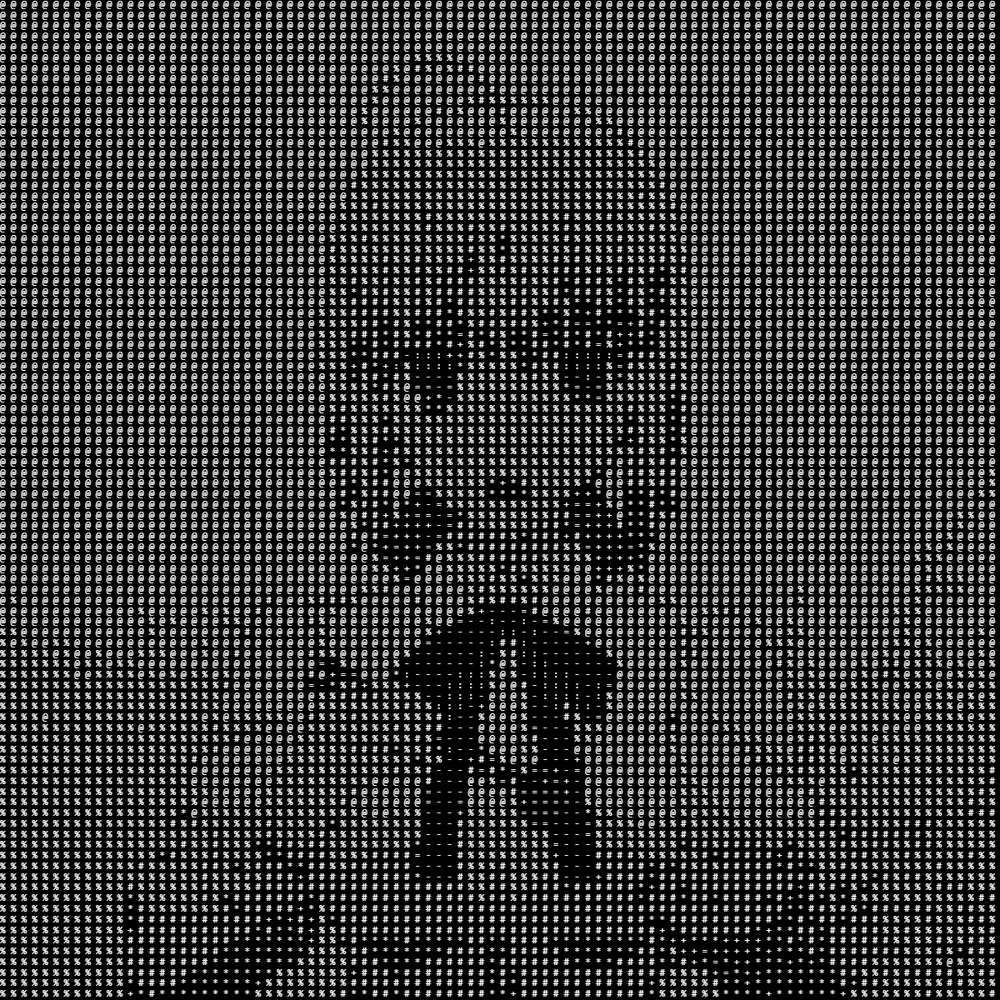

<h1 align="center">Saber ASCII Website</h1>

<p align="center">
  <strong>Saber, but make it ASCII, and she's eating.</strong>
</p>

<p align="center">
  
  
  
</p>

<p align="center">
  
</p>

I made this just for fun because I love Saber. It's a tiny website that plays an ASCII animation of her eating, in colorful characters on a black background. No build step, no dependencies, just open it and watch her nom.

## Try it

```bash
git clone https://github.com/ritsukasu/Saber-ASCII-Website-For-Fun.git
cd Saber-ASCII-Website-For-Fun
```

Then open `index.html` in your browser and enjoy.

## What's inside

```text
.
├── index.html      # the page
├── frames.js       # the animation frames
└── saber-noms.gif  # the preview above
```

---

<p align="center"><sub>Made with love for Saber by <a href="https://github.com/ritsukasu">ritsukasu</a></sub></p>
